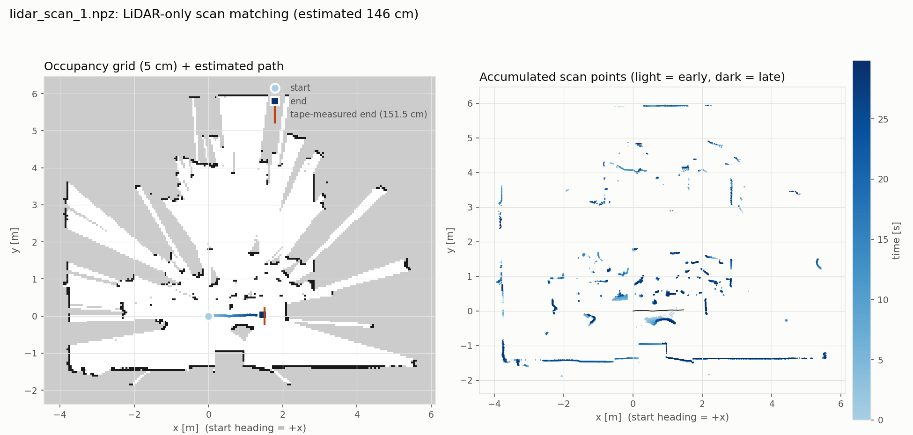

# TIKI-mini 학습 기록

하이버스이앤씨 H-TIKI-MINI 모바일 로봇으로 Python 제어, LiDAR·카메라 센서, OpenCV/YOLO 비전, 테스트베드 미션, ROS 2를 실습하며 정리하는 저장소입니다.

> 이 저장소에는 **직접 작성·수정한 코드와 실습 기록**만 담습니다. 교재와 강의 자료는 포함하지 않고 아래 링크로 참고합니다. 노트북은 강의 예제를 바탕으로 수정한 것이며, 각 노트북 첫 셀에 바꾼 점을 적어 두었습니다.

## 학습 자료

- 강의 사이트: https://irodmas.com/studytiki/

## 하드웨어 개요

- 로봇 컴퓨터(SBC): Raspberry Pi Compute Module 4 기반 TIKI SBC 보드 (Debian 계열 리눅스)
- 컨트롤러: ESP32 (모터, RGB LED, OLED, 부저, 배터리 측정, IMU)
- 개발 환경: Wi-Fi 연결 후 JupyterLab(브라우저)으로 코드 작성·실행
- 카메라: 외장 USB 웹캠 (컬러 + IR)
- LiDAR: RPLIDAR 계열 (`get_info()`의 모델 ID 65, 통신 속도 460800, `rplidar-roboticia` 라이브러리 사용)

## 진행 현황

| 항목 | 상태 | 비고 |
|---|---|---|
| 모터 제어 (PWM) | 완료 | 전진/후진/제자리 회전/커브 |
| RGB LED · 부저 · OLED | 완료 | |
| 배터리 전압·전류 | 완료 | |
| 외장 USB 웹캠 | 완료 | 컬러, IR 영상 확인 |
| LiDAR | 완료 | 정면 거리, 4방향 거리 |
| LiDAR + 모터 (장애물 정지) | 완료 | 300mm 이하에서 정지, 안전장치 시험 포함 |
| LiDAR 스캔 매칭 지도 | 부분 완료 | 손으로 민 기록 1회를 기록 후 처리. 추정 약 146 cm, 줄자 151.5 cm. 루프 클로저 없음 |
| IMU | 이상 | 응답이 0.00으로 고정(로봇을 움직여도 변하지 않음), 제조사 문의 예정 |
| 엔코더 | 일부 이상 | 후진할 때 왼쪽 값이 오른쪽보다 크게 적게 나옴, 원인 미확인 |
| 내장 CSI 카메라 | 미확인 | 부품(카메라 모듈, 리본 케이블) 누락, 외장캠으로 대체 |
| 비전 · 미션 · ROS 2 | 예정 | |

## 실습 노트북

| 노트북 | 내용 |
|---|---|
| [LiDAR/lidar_front_distance.ipynb](LiDAR/lidar_front_distance.ipynb) | 정면 0° ±5° 거리의 중앙값(mm)을 출력. 스캔 시작 실패 시 재시도 |
| [LiDAR/lidar_four_directions.ipynb](LiDAR/lidar_four_directions.ipynb) | 앞·뒤·좌·우(±10°) 거리를 0.3초마다 갱신. 읽기 스레드와 화면 갱신 분리 |
| [LiDAR/lidar_obstacle_stop.ipynb](LiDAR/lidar_obstacle_stop.ipynb) | 전진하다가 정면 300mm 이하에서 정지. 오류·값 갱신 중단·최대 주행 시간 시 정지, 가짜 오류(`SIMULATE`)로 안전장치 시험 |
| [LiDAR/lidar_single_scan_map.ipynb](LiDAR/lidar_single_scan_map.ipynb) | 스캔 한 바퀴를 위에서 본 점 그림(오른쪽·앞쪽 거리, m)으로 표시 |
| [LiDAR/lidar_scan.ipynb](LiDAR/lidar_scan.ipynb) | 로봇을 손으로 밀며 LiDAR 스캔을 30초 동안 기록해 `.npz`로 저장. 스캔 시작 실패 시 재시도 |
| [LiDAR/lidar_scan_map.ipynb](LiDAR/lidar_scan_map.ipynb) | 기록한 로그로 이동 경로를 추정하고 5 cm 점유 격자 지도를 만들어 줄자 실측과 비교 |

| 파일 | 내용 |
|---|---|
| [LiDAR/scanmatch.py](LiDAR/scanmatch.py) | 스캔 매칭(point-to-line ICP)과 점유 격자 지도 모듈 |
| [LiDAR/lidar_scan_1.npz](LiDAR/lidar_scan_1.npz) | 기록 로그 (301회전, 회전당 평균 387점, 약 10회전/초) |
| [LiDAR/lidar_scan_1_map.png](LiDAR/lidar_scan_1_map.png) | `lidar_scan_map.ipynb`가 만든 결과 이미지 |

### LiDAR 방향 기준

손으로 방향별로 가려서 확인한 결과, 로봇 기준으로 0°는 정면, 90°는 오른쪽, 180°는 뒤, 270°는 왼쪽입니다. 정면 거리는 자로 잰 값과 거의 일치했습니다.

### LiDAR 스캔 매칭으로 지도 만들기

엔코더와 IMU를 쓸 수 없는 상태여서, 로봇을 손으로 밀며 기록한 LiDAR 스캔만으로 이동 경로를 추정하고 지도를 만들었습니다.



| 항목 | 값 |
|---|---|
| 기록 | 30초, 301회전 |
| 스캔 매칭 추정 이동 거리 | 약 146 cm |
| 줄자 실측 (바퀴가 바닥에 닿는 지점 기준) | 151.5 cm |
| 차이 | −5.8 cm (−3.8%) |
| 매칭 실패 | 0회 |
| 로봇(RPi CM4)에서 실행 시간 | 스캔 매칭 4.8초, 지도 작성 19초 (기록 후 처리) |

- **방법**: 새 스캔을 최근 키프레임 10개로 만든 지도에 point-to-line ICP로 맞추고, 추정한 경로를 따라 5 cm 점유 격자를 쌓았습니다.
- **한계**: 루프 클로저와 전역 최적화가 없어 SLAM 전체가 아니라 앞단(스캔 매칭과 지도 작성)까지입니다. 정답 위치를 아는 기록이 줄자로 잰 시작·끝 거리 한 번뿐이라 정확도를 단정할 수 없습니다. 양옆이 평행한 긴 복도처럼 특징이 없는 곳에서는 앞뒤 이동을 구할 수 없습니다.
- 실시간 처리는 시도하지 않았습니다. 기록한 뒤에 처리한 결과입니다.
- 이 부분(`scanmatch.py`, `lidar_scan_map.ipynb`)은 강의 예제에 없는 내용이며, Claude의 도움을 받아 작성했습니다.

## 주행 실습 안전 메모

- 새 주행 코드는 먼저 **바퀴를 띄운 상태**에서 확인한 뒤 바닥에서 실행합니다.
- 최종 정지 수단은 **모터 전원 버튼**이므로, 주행 중에는 버튼 가까이에 손을 둡니다.
- JupyterLab의 코드는 PC가 아니라 **로봇 안에서** 실행됩니다. 무선 연결이 끊기면 `■`(Interrupt)를 누를 수 없으므로, 코드 안에 최대 주행 시간과 장애물 정지를 넣어 둡니다.
- 정지 거리는 속도(`DRIVE_POWER`)에 따라 달라집니다. 현재 값(80)에서만 확인했습니다.

## 트러블슈팅 기록

1. **SBC 부팅 불가**: STATUS LED가 켜지지 않고 HDMI 신호 없음. 원인은 SBC 보드의 점퍼(P2) 누락이었고, 점퍼를 꽂은 뒤 정상 부팅됨.
2. **시리얼 접속 무반응**: 속도 115200, 데이터 8비트, 정지 1비트, 패리티 없음, 흐름 제어 None으로 설정해야 함.
3. **JupyterLab 접속 불가**: PC(유선)와 로봇(Wi-Fi)이 서로 다른 네트워크에 있었음. USB Wi-Fi 동글로 PC를 로봇과 같은 네트워크에 연결해 해결.
4. **모터가 움직이지 않음**: 모터 전원 버튼이 주 전원과 별도. 모터 전원을 켠 뒤 정상 동작.
5. **내장 카메라 인식 불가**: `Picamera2`가 외장 USB 웹캠만 잡음. CSI 카메라 모듈과 케이블이 처음부터 없었던 것으로 확인.
6. **IMU 값 고정**: `get_imu()`와 원본 응답 모두 0.00. 엔코더·배터리 등 같은 통신 경로의 다른 값은 정상이라 IMU 기능만 문제로 좁힘. 로봇을 손으로 움직이며 10초 동안 다시 읽어도 `[0.0, 0.0, 0.0]`에서 변하지 않았음.
7. **공유기 Wi-Fi 사용 불가**: 공유기의 Wi-Fi가 고장나 로봇과 PC를 같은 네트워크에 둘 수 없었음. 휴대폰 핫스팟에 로봇과 PC(USB Wi-Fi 동글)를 함께 연결해 JupyterLab에 접속.
8. **LiDAR 스캔 시작이 간헐적으로 실패**: `RPLidarException: Descriptor length mismatch`가 `iter_measures()`의 시작 단계에서 발생. 통신 속도를 바꿔 보면 460800에서만 `get_info()`·`get_health()`가 응답했으므로 속도 불일치는 아님. 같은 코드가 어떤 때는 실패하고 어떤 때는 성공했고, 모터를 먼저 돌려 대기하는 가설은 지지되지 않았음. **원인은 확인하지 못함.** 실패하면 `stop()`으로 정리한 뒤 최대 5번 재시도하도록 우회했고, 이후 실행에서는 1~3번 안에 시작에 성공함.
9. **디버그 로그를 켜면 LiDAR 값이 나오지 않음**: `logging`을 DEBUG로 켠 채 스캔하면 샘플마다 로그가 출력되어 루프가 느려지고, `Too many bytes in the input buffer` 경고와 함께 스캔이 반복해서 재시작됨. 재시작할 때마다 약 25°~40° 구간만 읽다가 끊겨 정면(355°~5°) 값이 출력되지 않았음. 로깅을 끄자 정상 수신(초당 약 5,100개). 로그 출력량이 원인으로 판단하나, 샘플별 로그 외 다른 요인은 배제하지 못함.
10. **후진할 때 왼쪽 엔코더가 덜 셈**: 같은 거리를 후진했을 때 왼쪽 엔코더 값이 오른쪽의 약 0.54~0.56배로 나왔음. 원인은 확인하지 못함. 같은 PWM에서 오른쪽 바퀴가 약 3.5% 빨라 로봇이 왼쪽으로 휘었음. 제자리 회전으로 바퀴 간격을 보정하려 했으나 결과가 일관되지 않아 마치지 못함. 그래서 이동 추정은 엔코더 대신 LiDAR 스캔 매칭을 사용함.
11. **LiDAR에 손과 몸이 찍힘**: 손으로 밀며 기록하면 손이나 몸이 LiDAR 옆에 있을 때 로봇과 함께 움직이는 점이 기록됨. `lidar_scan_1.npz`에서도 15~24초 사이 오른쪽(75~105°) 약 25 cm 거리에 점이 찍혔고 손이나 팔로 추정함. 30 cm 안의 점을 제외해도 추정 이동 거리는 0.2 cm만 달라져 이번 기록에서는 영향이 작았음. 기록할 때는 로봇 뒤쪽을 밀거나 몸을 LiDAR에서 멀리 둠.
12. **재부팅 후 JupyterLab 접속 불가**: 로봇이 이전에 쓰던 공유기 Wi-Fi에 자동으로 연결되어 핫스팟 주소로 접속되지 않았음. 로봇 터미널에서 핫스팟 연결을 직접 켜서 해결함.

## 폴더 구조

```
TIKI-MINI-LiDAR-STUDY/
├── README.md
├── .gitignore
└── LiDAR/
    ├── lidar_front_distance.ipynb
    ├── lidar_four_directions.ipynb
    ├── lidar_obstacle_stop.ipynb
    ├── lidar_single_scan_map.ipynb
    ├── lidar_scan.ipynb
    ├── lidar_scan_1.npz
    ├── scanmatch.py
    ├── lidar_scan_map.ipynb
    └── lidar_scan_1_map.png
```

실습이 쌓이면 챕터별로 폴더를 추가할 예정입니다.
